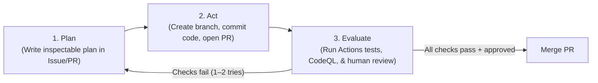

# Module 1: Foundations of Agentic AI in GitHub

This guide covers the foundational concepts in **Domain 1 (Prepare Agent Architecture and SDLC Processes)** and **Domain 6 (Implement Guardrails and Accountability)** of Exam GH-600.

---

## What Agentic AI in the SDLC is and why you use it

**Agentic AI** *(goal-driven AI systems that plan steps, call tools, edit branches, and iterate from feedback)* goes beyond single-turn chat suggestions by performing multi-step engineering tasks inside GitHub. Without an agentic workflow, a developer must copy every AI code suggestion by hand, create branches, run tests, and fix errors manually. By default, GitHub agents work inside standard repository structures—creating branches and Pull Requests rather than pushing straight to `main`.

### Choosing between an AI Assistant, Rule-Based Automation, and an AI Agent

| Situation (Exam Clue) | Best Choice | Why |
| :--- | :--- | :--- |
| Explaining a function or suggesting a code snippet in the editor while the human makes all repo changes | **AI Assistant** *(suggestion-only tool)* | Responds to one prompt at a time and leaves branching, testing, and committing to the developer. |
| Running the exact same test script or linter every time someone pushes a commit | **Rule-driven Automation** *(deterministic CI/CD script)* | Follows fixed YAML steps without interpreting open-ended goals or revising its own plan. |
| Resolving a Dependabot security alert by planning a fix, updating files on a branch, checking CI results, and fixing failing tests | **AI Agent** *(goal-driven, iterative system)* | Breaks a high-level goal into steps, calls tools, checks test results, and iterates until checks pass. |

---

## How the Plan → Act → Evaluate lifecycle works

Every reliable agent on GitHub runs in an iterative **Plan → Act → Evaluate loop** *(proposing a clear plan, making changes on an isolated branch, and checking results against automated tests and human review)*. If an agent skips straight to writing code without a visible plan, reviewers waste time reading huge, unfocused diffs. By default, an agent only finishes its loop when objective system checks pass—or when it hits a retry limit and escalates to a human.

1. **Plan (Make intent inspectable):** The agent writes its goal, file scope, steps, risks, and test plan into an Issue comment, PR description, or plan artifact before changing production code.
2. **Act (Execute bounded changes):** The agent uses GitHub APIs or CLI tools to create an isolated working branch, commit changes, and open or update a Pull Request.
3. **Evaluate (Check objective system signals):** GitHub validates the PR using **objective evaluation signals** *(pass/fail results from unit tests, CodeQL scans, dependency reviews, secret scans, and human reviewers)*—never the agent's own confidence score.

> [!WARNING]
> **Exam Watch-Out:** Never evaluate an agent based on its self-reported confidence (*"I have verified that all requirements are met"*). On the exam, evaluation in the `Plan → Act → Evaluate` loop must always rely on **objective system signals** such as GitHub Actions test runs, CodeQL alerts, secret scanning, and human code reviews.

---

## How GitHub acts as both System of Record and Control Plane

When autonomous agents work in your repository, you need one place to see what happened and one place to block unsafe actions. GitHub serves two distinct roles: the **System of Record** *(the permanent log of every goal, plan, commit, check result, and review decision)* and the **Control Plane** *(the policy engine that enforces rulesets, status checks, permissions, and environment approvals)*.

### Choosing between System of Record artifacts and Control Plane features

| GitHub Feature (Exam Clue) | Role in Agent Architecture | What It Does |
| :--- | :--- | :--- |
| **Issues, Commits, PR History, and Workflow Artifacts** | **System of Record** *(visibility & auditability)* | Captures a permanent timeline of *why* a task started, *what* changed, and *what* test evidence proved it worked. |
| **Pull Requests & Branch Protection / Rulesets** | **Control Plane** *(boundary enforcement)* | Blocks agents from pushing straight to `main` and forces every change into a reviewable proposal. |
| **Required Status Checks** | **Control Plane** *(automated quality gate)* | Disables the merge button until unit tests, linters, and security scans report a passing status. |
| **`CODEOWNERS` + Required Code Owner Reviews** | **Control Plane** *(domain ownership routing)* | Forces human experts from `@security-team` or `@platform-team` to approve edits to sensitive folders. |
| **Protected GitHub Environments** | **Control Plane** *(deployment & secret gate)* | Pauses production deployments and hides production secrets until designated human reviewers approve. |
| **Workflow `permissions:` (`GITHUB_TOKEN`)** | **Control Plane** *(capability boundary)* | Limits what API actions the agent's runner job can perform (defaulting to read-only access). |

---

## What the Contributor Model and Agent Anti-Patterns are

Under the **Contributor Model** *(treating an AI agent like a fast, capable, but fallible human teammate who submits Pull Requests)*, agent-written code goes through the exact same review and CI gates as human code. While an agent can perform the work, **human accountability** *(the rule that human engineers and reviewers always own production stability, security, and compliance)* never transfers to an AI model.

### How to review an agent Pull Request using the 4-Part Contributor Rubric

1. **Intent and plan alignment:** Verify that the PR links to the originating Issue and that the code diff actually follows the stated plan.
2. **Scope and blast radius:** Check that the agent only touched files required for the task and stayed out of `.github/workflows/`, `infra/`, or `auth/` unless instructed.
3. **Objective evidence:** Confirm that CI tests, CodeQL scans, and dependency reviews ran and passed, and that new tests cover new behavior.
4. **Maintainability and security:** Read the diff for subtle logic bugs, hardcoded values, or style violations that automated linters might miss.

### Spotting and fixing the 5 classic Agent Anti-Patterns

| Agent Anti-Pattern (Exam Clue) | What Goes Wrong | How to Fix It in GitHub |
| :--- | :--- | :--- |
| **Planless execution** *(agent opens a 40-file PR with no stated plan)* | Reviewers cannot tell if the agent solved the right problem or broke architecture rules. | Require a structured Plan section via a PR template and enforce a **Plan Gate status check**. |
| **Unbounded scope / Scope creep** *(agent fixes a typo and also refactors the login module)* | Unrelated changes increase merge conflicts and hide regressions. | Restrict the agent's file scope (`applyTo` / task contract) and reject out-of-scope edits in PR review. |
| **Unverified autonomy** *(agent merges its own PR or deploys without checks)* | Broken or vulnerable code ships to production before anyone notices. | Enable **Repository Rulesets** requiring status checks and human approval before merge. |
| **Over-permissioned tokens** *(agent runs with write-all token and all repo secrets)* | A prompt injection or bug can overwrite branches or leak production credentials. | Set `permissions: contents: read` by default and scope secrets to protected **Environments**. |
| **Opaque execution** *(agent reasoning and results live only in a temporary chat window)* | Teams have zero forensic audit trail when debugging an incident later. | Record plans in PR descriptions and upload structured reports via `actions/upload-artifact@v4`. |

> [!IMPORTANT]
> **Rule of Thumb (Minimum Audit Trail):** Every agent contribution on GitHub must leave **six auditable traces**: (1) a stated goal in an Issue/PR, (2) an inspectable plan, (3) an isolated branch and commits, (4) automated check/scan evidence, (5) a human review decision, and (6) a clear merge, revert, or escalation record.
