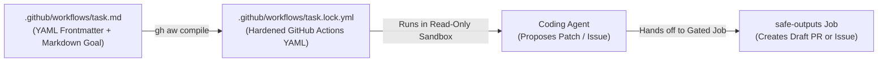

# Module 3: Tooling, MCP, and Agent Execution Environments

This guide covers **Domain 2 (Implement Tool Use and Environment Interaction)** of Exam GH-600, including **GitHub Agentic Workflows (`gh aw`)**, **Model Context Protocol (MCP)** governance, and **Copilot CLI** execution in GitHub Actions.

---

## What GitHub Agentic Workflows are and why you use them

**GitHub Agentic Workflows (`gh aw`)** *(Markdown files that let a coding agent perform repository tasks inside GitHub Actions under strict guardrails)* let you automate open-ended work like issue triage, status reports, and doc updates alongside traditional CI/CD. Unlike a regular YAML workflow that runs fixed shell commands, an agentic workflow pairs a plain-English Markdown goal with YAML **frontmatter** *(the settings block between `---` lines at the top of a Markdown file)*. By default, the coding agent runs inside a read-only container with zero access to repository secrets.

### How a GitHub Agentic Workflow compiles and runs safely



1. **You write the workflow in Markdown (`.md`):** The YAML frontmatter sets triggers, permissions, allowed tools, network rules, and **`safe-outputs`** *(a separate, permission-gated step that applies approved writes like creating a PR or issue)*.
2. **You compile it into a lock file (`.lock.yml`):** Running `gh aw compile` turns your `.md` file into a hardened `.lock.yml` workflow that GitHub Actions actually executes.
3. **The agent runs in a read-only sandbox:** The coding agent inspects code and drafts changes with read-only permissions, zero secrets, and an outbound network allowlist.
4. **The `safe-outputs` job applies the write:** After threat detection scans the agent's output, a separate gated job opens the draft Pull Request or Issue for human review.

### Choosing between Traditional Workflows and GitHub Agentic Workflows

| Situation (Exam Clue) | Best Choice | Why |
| :--- | :--- | :--- |
| Running deterministic unit tests, builds, or fixed deployment scripts | **Traditional GitHub Actions Workflow (`.yml`)** | Executes exact, repeatable commands where every step is known ahead of time. |
| Summarizing changelog notes, triaging issues, or drafting doc updates from web sources | **GitHub Agentic Workflow (`.md` + `.lock.yml`)** | Uses an AI agent to reason through open-ended tasks while enforcing frontmatter guardrails and `safe-outputs`. |

### Setting up and compiling a GitHub Agentic Workflow (`gh aw`)

By default, GitHub Actions cannot run a `.md` workflow file directly—you must initialize the repository with `gh aw` and compile the Markdown file into a `.lock.yml` file.

To install the `gh aw` CLI extension on your machine:

```bash
curl -fsSL https://raw.githubusercontent.com/github/gh-aw/main/install-gh-aw.sh | bash
```

To initialize your repository with the required agentic workflow skills, MCP config, and setup steps, run `gh aw init`:

```bash
gh aw init --create-pull-request --engine copilot --completions
```

Running `gh aw init` creates five setup files in your repository:

```text
repository-root/
├── .gitattributes
└── .github/
    ├── agents/agentic-workflows.md
    ├── mcp.json
    ├── skills/agentic-workflows/SKILL.md
    └── workflows/copilot-setup-steps.yml
```

To define an agentic workflow that fetches approved GitHub web pages and opens a draft Pull Request via `safe-outputs`, create `.github/workflows/update-github-info.md`:

```markdown
---
name: update-github-info
description: Draft website updates from official GitHub sources.
on:
  workflow_dispatch:
  schedule:
    - cron: '17 9 * * *'
safe-outputs:
  create-pull-request:
    title-prefix: "[mona] "
    draft: true
    fallback-as-issue: false
tools:
  edit:
  web-fetch:
network:
  allowed:
    - github.com
    - github.blog
    - awesome-copilot.github.com
engine:
  id: copilot
  copilot-sdk: true
---

Read `notes/mona-notes.md` and fetch updates from `https://github.blog/changelog/`.
Update `site/content/github-info.md` and propose the changes as a draft pull request.
```

To compile your Markdown workflow into the `.lock.yml` file that GitHub Actions runs:

```bash
gh aw compile .github/workflows/update-github-info.md
```

> [!WARNING]
> **Exam Watch-Out:** You must commit **both** the `.md` source file and the compiled `.lock.yml` file to your `main` branch. Also, to let the workflow call Copilot, create a **fine-grained Personal Access Token (PAT)** with **Copilot Requests: Read** (`user_copilot_requests=read`) and save it as a repository secret named `COPILOT_GITHUB_TOKEN`.

---

## What Model Context Protocol (MCP) Governance is and why you use it

**Model Context Protocol (MCP)** *(an open standard that connects AI agents to external tools, databases, and APIs without custom glue code)* lets agents query issue trackers, cloud APIs, or local scripts. Without governance, developers could connect agents to unverified third-party servers that leak code. GitHub governs MCP using three layers: **MCP Servers** *(the tools themselves)*, an **MCP Registry** *(a trusted catalog of approved servers)*, and **MCP Allow Lists** *(org or enterprise rules that block unapproved servers)*.

### Choosing between Remote and Local MCP Servers

| Situation (Exam Clue) | Best Choice | Why |
| :--- | :--- | :--- |
| Connecting VS Code or cloud agents to GitHub tools across a team with zero local setup | **Remote MCP Server** (`https://api.githubcopilot.com/mcp/`) | Runs over HTTPS with OAuth sign-in, working identically across developer machines. |
| Accessing files or custom scripts on a developer's laptop, or running on **GitHub Enterprise Server (GHES)** | **Local MCP Server** (`http://localhost:3000`) | Runs locally without external OAuth; supported on both GHES and GitHub Enterprise Cloud. |
| Running on **GitHub Enterprise Cloud (with data residency)** | **Both Local and Remote MCP Servers** | Enterprise Cloud supports both local and remote MCP configurations. |

### Configuring a custom MCP Registry and enforcing Allow Lists

By default, organizations can choose between **Allow all** *(developers can use any MCP server)* and **Registry only** *(agents can only run servers listed in your approved MCP Registry URL)*.

To host a custom **MCP Registry** (or configure **Azure API Center** with anonymous access), your registry must follow the **MCP registry v0.1 specification** and expose three `GET` endpoints:

```text
GET /v0.1/servers
GET /v0.1/servers/{serverName}/versions/latest
GET /v0.1/servers/{serverName}/versions/{version}
```

To allow GitHub Copilot to fetch your registry, your server must return these three **CORS headers** *(browser security headers that allow cross-domain requests)*:

```http
Access-Control-Allow-Origin: *
Access-Control-Allow-Methods: GET, OPTIONS
Access-Control-Allow-Headers: Authorization, Content-Type
```

> [!WARNING]
> **Exam Watch-Out (Two Classic MCP Registry Traps):**
> 1. **Azure API Center URL:** When entering an Azure API Center URL as your MCP Registry URL in GitHub settings, enter the **base URL only**—do **not** append `/v0.1/servers` to the end.
> 2. **Local Servers Under `Registry only`:** When you set your policy to **Registry only**, *even local MCP servers* must be listed in the registry with an **exact matching server ID**, or Copilot will block them immediately.

---

## How Execution Context and Boundaries protect your repository

An agent's **execution context** *(the repository, base branch, workflow runner, and token permissions where the agent runs)* defines what the agent can touch. Even if a prompt tells an agent to edit another repo or push straight to `main`, platform boundaries block the action. By default, **Copilot in the cloud** isolates work inside one repository, branches off your chosen **base branch**, and never merges its own Pull Request.

### Choosing between Custom Agent settings and Execution Context controls

| Capability | Controlled by Custom Agent (`.agent.md`)? | Controlled by Execution System (Actions / Cloud)? |
| :--- | :--- | :--- |
| **File focus (`applyTo`)** and **instructions** | **Yes** | No |
| **Available agent tools (`tools`)** | **Yes** | Enforced by platform allowlists |
| **Branch creation and isolation** | **No** | **Yes** (always branches off base branch) |
| **Opening or merging Pull Requests** | **No** | **Yes** (governed by workflow and branch rules) |

### Running Copilot CLI non-interactively in GitHub Actions

By default, Copilot CLI prompts a human before running actions. When running inside a CI workflow job, you must pass `--no-ask-user` so the job does not hang waiting for keyboard input.

To run a standard prompt with Copilot CLI inside a GitHub Actions workflow using `COPILOT_GITHUB_TOKEN`:

```yaml
name: Scheduled Agent Summary
on:
  workflow_dispatch:
  schedule:
    - cron: '0 9 * * *'

permissions:
  contents: read

jobs:
  summarize:
    runs-on: ubuntu-latest
    steps:
      - uses: actions/checkout@v4
      - uses: actions/setup-node@v4
        with:
          node-version: '18'
      - name: Run Copilot CLI non-interactively
        env:
          COPILOT_GITHUB_TOKEN: ${{ secrets.GITHUB_TOKEN }}
        run: |
          npx @github/copilot-cli -p "Summarize recent changes in this repository" --no-ask-user
```

To invoke a specific custom agent (such as `security-reviewer`) in CI, add the `--agent` flag:

```bash
npx @github/copilot-cli --agent security-reviewer -p "Review this code for vulnerabilities" --no-ask-user
```

---

## Configuring execution limits, retries, and loop prevention

Autonomous workflows must handle network blips gracefully without getting stuck in infinite loops. You can combine **fail-fast error handling** *(stopping the job immediately when a critical step fails)* with **bounded retries** *(retrying a flaky command a fixed number of times before giving up)*. By default, GitHub also prevents infinite workflow loops through built-in `GITHUB_TOKEN` event rules.

### Stopping a workflow immediately on agent failure (`continue-on-error: false`)

By default, workflow steps stop on a non-zero exit code unless someone enables `continue-on-error: true`.

To make sure a failed agent step halts the pipeline immediately so broken state never passes to later steps, set `continue-on-error: false`:

```yaml
      - name: Run critical agent step
        continue-on-error: false
        run: npx @github/copilot-cli -p "Validate schema changes" --no-ask-user
```

### Retrying transient agent errors with a bounded loop

To retry a temporary API or network glitch up to 3 times with a 5-second pause before failing:

```yaml
      - name: Run agent task with bounded retry
        run: |
          for i in 1 2 3; do
            npx @github/copilot-cli -p "Run task" --no-ask-user && break
            sleep 5
          done
```

### Choosing the right token for workflow trigger chaining (`GITHUB_TOKEN` vs. PAT)

| Situation (Exam Clue) | Best Token Choice | Why |
| :--- | :--- | :--- |
| Preventing an agent's commit or PR creation from accidentally starting an infinite loop of new workflow runs | **Built-in `GITHUB_TOKEN`** | Events created with `GITHUB_TOKEN` **never trigger new workflow runs** by design. |
| Intentionally allowing an agent's new Pull Request to trigger a downstream CI test workflow | **Personal Access Token (PAT) or GitHub App Token** | Events created with a PAT or GitHub App token **do trigger** downstream `on: pull_request` or `on: push` workflows. |

> [!IMPORTANT]
> **Rule of Thumb:** If an exam scenario says *"An agent opened a Pull Request inside a GitHub Actions job, but the `on: pull_request` CI workflow did not start,"* the cause is that the agent used the default **`GITHUB_TOKEN`**. Switch that step to a **GitHub App token** or **fine-grained PAT** (and add concurrency/branch guards to prevent infinite loops).
