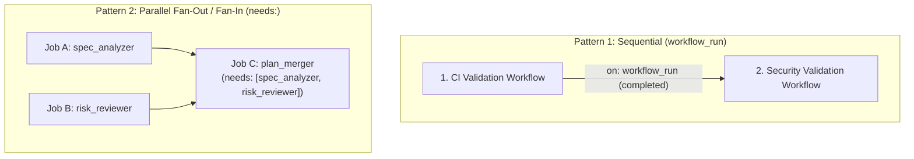

# Module 4: Multi-Agent Systems and Orchestration

This guide covers **Domain 5 (Orchestrate Multi-Agent Coordination)** of Exam GH-600, including multi-agent role boundaries, sequential and fan-out/fan-in workflows, branch and concurrency isolation, conflict arbitration, and custom agent handoffs (`.github/agents/`).

---

## What Multi-Agent Coordination is and why you use it

When multiple specialized agents—like a Dependency Agent, Refactoring Agent, and Security Agent—work in the same repository, they can overwrite each other's files or trigger endless workflow loops. **Multi-agent orchestration** *(coordinating multiple specialized agents using branches, pull requests, workflow events, and artifacts)* keeps agents from colliding. By default, GitHub follows one golden rule for multi-agent work: **agents propose changes on isolated branches, while human reviewers and repository policies accept and merge them**.

### How to partition file and SDLC boundaries across multiple agents

```text
Repository Scope Partitioning
├── Dependency Agent   ──► Allowed: package.json, lockfiles   | Forbidden: src/, .github/workflows/
├── Refactoring Agent  ──► Allowed: src/**                    | Forbidden: lockfiles, .github/workflows/
├── Security Agent     ──► Allowed: security reports & fixes  | Forbidden: general app refactoring
└── Platform Team      ──► Sole human owners of .github/workflows/ and /infra/ via CODEOWNERS
```

### Choosing which GitHub artifact represents each SDLC stage

| SDLC Stage (Exam Clue) | Multi-Agent Responsibility | Reviewable GitHub Artifact |
| :--- | :--- | :--- |
| **Planning** | Define goal, file scope, step dependencies, and rollback plan | PR plan section or `PLAN.md` |
| **Implementation** | Write code changes inside an isolated workspace | Dedicated branch (`agent/<role>/<ticket>`) + commits + PR |
| **Validation** | Run tests, security scans, and generate proof | GitHub Actions runs + status checks + uploaded workflow artifacts |
| **Acceptance** | Enforce ownership rules and human sign-off | `CODEOWNERS` + required reviews + required status checks |
| **Deployment** | Gate high-risk releases to staging or production | Protected **GitHub Environments** + required human reviewers |

---

## Orchestrating multi-agent workflows in GitHub Actions

Instead of letting agents send hidden messages to each other in memory, **event-driven orchestration** *(triggering agent workflows through GitHub events like `workflow_run`, `pull_request`, and `needs:`)* records every handoff in the Actions tab. By default, jobs in a workflow run in parallel unless you chain them with `needs:` or separate workflows with `workflow_run`.

### How Sequential vs. Fan-Out / Fan-In Orchestration works



### Choosing the right multi-agent orchestration pattern

| Situation (Exam Clue) | Best Orchestration Pattern | Why |
| :--- | :--- | :--- |
| Running a security agent workflow only after the main CI build workflow finishes | **Sequential orchestration (`on: workflow_run` with `types: [completed]`)** | Waits for the upstream workflow to complete before starting the downstream agent workflow. |
| Running two read-only analysis agents at the same time and combining their findings in a third job | **Parallel Fan-Out / Fan-In (`needs: [job_a, job_b]`)** | Runs independent analysis jobs in parallel (fan-out) and waits for both to finish before merging the plan (fan-in). |
| Passing findings from a read-only reasoning agent to a separate job that opens an issue | **Artifact-based coordination (`actions/upload-artifact@v4`)** | Keeps the reasoning agent read-only and lets a narrow write-scoped job read `report.json` to create the issue. |

### Chaining sequential workflows with `workflow_run`

To trigger a Security Validation workflow automatically only after the `CI Validation` workflow finishes:

```yaml
name: Security Validation
on:
  workflow_run:
    workflows: [CI Validation]
    types: [completed]

jobs:
  validate:
    runs-on: ubuntu-latest
    steps:
      - run: echo "Run security validation agent after CI completes."
```

### Combining parallel agent outputs with the Fan-Out / Fan-In pattern (`needs:`)

To run `spec_analyzer` and `risk_reviewer` in parallel and wait for both to finish before `plan_merger` combines their outputs:

```yaml
jobs:
  spec_analyzer:
    runs-on: ubuntu-latest
    steps:
      - run: ./executors/spec_analyzer.sh

  risk_reviewer:
    runs-on: ubuntu-latest
    steps:
      - run: ./executors/risk_reviewer.sh

  plan_merger:
    runs-on: ubuntu-latest
    needs: [spec_analyzer, risk_reviewer]
    concurrency:
      group: multiagent-${{ github.ref }}
    steps:
      - run: ./executors/plan_merger.sh
```

---

## Isolating agent execution with branches, permissions, and concurrency

When several agents push updates to pull requests at the same time, workflows can pile up and waste runner minutes. **Execution isolation** *(separating agents by branch names, workflow files, token permissions, and concurrency groups)* keeps one noisy agent from blocking another. By default, **Copilot in the cloud** and **Copilot CLI** can run multiple parallel agent sessions across tasks, whereas a **Local IDE** session runs only one task at a time (serially).

### Stopping overlapping runs per workflow and branch with `concurrency`

By default, pushing three quick commits to a PR starts three simultaneous runs of the same workflow.

To cancel older in-progress runs of the *same* workflow on the *same* branch without canceling other workflows running on that branch, combine `${{ github.workflow }}` and `${{ github.ref }}` in your `concurrency` group:

```yaml
concurrency:
  group: ${{ github.workflow }}-${{ github.ref }}
  cancel-in-progress: true
```

> [!WARNING]
> **Exam Watch-Out:** Never set your concurrency group to just `group: ${{ github.ref }}` on a multi-agent repo! Leaving out `${{ github.workflow }}` puts *every* workflow on that branch into the same group, so a security scan workflow will accidentally cancel your unit test workflow.

---

## Resolving multi-agent conflicts and auditing missing evidence

Even with scoped folders, two agents can still collide. GitHub categorizes multi-agent collisions into four types: **textual merge conflicts** *(two agents edit the same lines)*, **semantic conflicts** *(files merge cleanly in Git, but the combined code breaks tests at runtime)*, **policy conflicts** *(edits touch protected folders needing special sign-off)*, and **duplicate effort** *(two agents open competing PRs for the same bug)*.

### Catching textual merge conflicts early in CI

By default, a PR check only tests the agent's branch snapshot unless you test-merge the latest `main` branch.

To fail a status check immediately if an agent's branch conflicts with `origin/main`, run a no-commit test merge in your workflow:

```yaml
      - name: Validate clean merge with main
        run: |
          git fetch origin main
          git merge --no-commit origin/main
```

### Choosing the right conflict resolution or audit action

| Situation (Exam Clue) | Best Action | Why |
| :--- | :--- | :--- |
| An agent PR hits a merge conflict **twice** after rebase attempts, or a required check fails **twice** with the exact same error | **Stop retries and escalate to a human reviewer** | Enforces the **2-strike escalation threshold** instead of burning tokens in a non-converging loop (**flapping**). |
| A workflow run finishes, but its uploaded evidence artifact (`agent-report`) is suddenly missing | **Search the Organization Audit Log for `action:artifact.destroy`** | Shows the exact user or token that deleted the artifact, along with the timestamp and repository. |
| An agent session appears stalled or slow and you need to watch its live output from the terminal | **Run `gh agent-task view --log --follow`** | Streams the live agent session logs directly in the GitHub CLI. |
| A repository ruleset requiring **signed commits** blocks the Copilot coding agent from pushing to `copilot/*` branches | **Add `"GitHub Copilot"` as a bypass actor in the Repository Ruleset** | Lets the Copilot agent push to its automation branches while still forcing human developers to sign every commit. |

---

## Coordinating custom subagents and handoffs in `.github/agents/`

You can build a team of specialized custom agents (such as **Orchestrator**, **Planner**, **Designer**, and **Coder**) inside `.github/agents/*.agent.md`. A parent orchestrator agent delegates tasks to subagents using the `agents:` allowlist and `handoffs:` transitions in YAML frontmatter. By default, any custom agent in `.github/agents/` can be picked by a user in the UI or called by another agent unless you restrict its invocation keys.

### Configuring subagent allowlists and automatic handoffs in `.agent.md`

To allow a parent `planner.agent.md` to invoke `implementer` and `code-review` as subagents and automatically submit the implementation handoff using `send: true`:

```yaml
---
name: Planner
description: Researches the codebase and creates an implementation plan.
model: Claude Opus 5.5 (copilot)
tools: ['read', 'search', 'web', 'memory', 'todo']
agents: [implementer, code-review]
handoffs:
  - label: Start Implementation
    agent: implementer
    send: true
    model: GPT-5.2
  - label: Run Review
    agent: code-review
    prompt: Review the code changes made in the previous step.
---
```

### Choosing between `disable-model-invocation` and `user-invocable`

| Frontmatter Key in `.agent.md` (Exam Clue) | What It Blocks | What Still Works |
| :--- | :--- | :--- |
| **`disable-model-invocation: true`** | Blocks other agents from calling this agent as a **subagent** (causes orchestration failure if listed in `agents:` / `handoffs:`). | Human users can still pick and run the agent manually from the UI or CLI. |
| **`user-invocable: false`** | Hides the agent from the **human UI dropdown selector** so users cannot pick it manually. | Parent orchestrator agents can still call it in the background as a **subagent**. |

### Running a multi-agent team interactively in Copilot CLI

To launch Copilot CLI with all tools and GitHub MCP tools enabled for a multi-agent lab session:

```bash
copilot --allow-all --enable-all-github-mcp-tools
```

Once inside the interactive Copilot CLI prompt, use slash commands to sign in, configure multiline input, and pick your **Orchestrator** agent:

```text
/login
/terminal-setup
/agent
```

> [!IMPORTANT]
> **Rule of Thumb (Orchestrator File Assignment):** When an **Orchestrator** agent delegates work to specialist subagents (such as a **Designer** and a **Coder**), it may run them **in parallel** only when their assigned file paths and data dependencies do not overlap. If two steps touch the same file (`app/styles.css`) or depend on an earlier step's output (`docs/project-pulse-plan.md`), the Orchestrator must run them **sequentially**.
