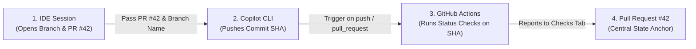

# Module 5: Memory, State, and Evaluation

This guide covers **Domain 3 (Manage Memory, State, and Execution)** and **Domain 4 (Perform Evaluation, Error Analysis, and Tuning)** of Exam GH-600.

---

## What Agent Memory Strategies are and why you use them

**Agent memory** *(the information an AI agent keeps to understand rules, past choices, and current goals)* prevents an agent from forgetting project requirements or repeating mistakes across tasks. Think of it like a developer's desk: you keep active notes on a scratchpad, team coding standards in a handbook, and official project tickets in GitHub. By default, an agent's chat session is **ephemeral** *(temporary and wiped as soon as the session ends)*.

### How GitHub organizes the memory hierarchy

```text
GitHub Repository (External Memory — Authoritative Source of Truth)
├── Issues                 # Task requirements & acceptance criteria
├── Pull Requests          # Implementation plans & central state anchor
├── .github/
│   ├── copilot-instructions.md   # Long-term memory (repeatable repo rules)
│   └── workflows/                # Automated validation & artifact generation
└── Actions Artifacts      # Execution logs & test reports (90-day default retention)
```

### Choosing between Short-Term, Long-Term, and External Memory

| Situation (Exam Clue) | Best Choice | Why |
| :--- | :--- | :--- |
| Tracking immediate prompt instructions or tool feedback during a single run | **Short-term memory** *(temporary in-session working context)* | Holds active reasoning steps during a run and clears automatically when the session finishes. |
| Reusing coding standards, architecture rules, or validation steps across many tasks | **Long-term memory** *(curated instructions and skills saved for future runs)* | Stores repeatable repository guidance in instruction files so you do not re-explain rules every time. |
| Requiring an auditable **source of truth** *(the single official record everyone trusts)* for requirements and decisions | **External memory** *(durable records stored outside the agent in GitHub Issues, PRs, and artifacts)* | Survives session restarts and gives both humans and agents one permanent place to verify facts. |
| Preventing old logs or outdated plans from confusing future agent runs | **Memory pruning and expiration** *(deleting obsolete records and setting time limits on temporary files)* | Removes clutter and forces temporary build or test outputs to expire automatically. |

> [!WARNING]
> **Exam Watch-Out:** Never rely on **short-term memory** or cached chat history as your source of truth. On the exam, **external memory** stored in durable GitHub artifacts (**Issues** and **Pull Requests**) is always the authoritative source of truth.

---

## What Agent State and Context Drift are and why you manage them

**Agent state** *(the record of what steps the agent has finished, what decisions it made, and what work remains)* lets an agent pause and resume multi-step work without starting over. Without a durable state record, the agent suffers from **context drift** *(when an agent's actions slowly wander away from the original goal or earlier decisions)*. By default, a **Pull Request (PR)** serves as the **central state anchor** *(the main hub that ties together your plan, code commits, and test results)* in GitHub.

### How an agent resumes work across sessions without repeating steps

1. **Agent locates the state anchor:** The agent opens the existing Pull Request and reads the PR description and linked Issue to restore the goal.
2. **Agent checks completed progress:** The agent inspects the branch's Git commit history to see which files are already changed.
3. **Agent verifies validation status:** The agent reads the **Checks** tab to see which automated tests passed or failed on the latest commit.
4. **Agent continues from the last verified step:** The agent writes only the remaining code or fixes the failing check instead of redoing finished work.

### Choosing where to store state and how to handle drift

| Situation (Exam Clue) | Best Choice | Why |
| :--- | :--- | :--- |
| Defining initial task scope and **acceptance criteria** *(the checklist a feature must pass to be considered done)* | **GitHub Issue** | Captures the original problem and success checklist before any code is written. |
| Tracking the active implementation plan, design updates, and review status in one place | **Pull Request description** | Acts as the **central state anchor** linking commits, comments, and CI checks. |
| Recording small, step-by-step code changes that can be rolled back | **Git Commits** | Saves each incremental change on the branch with a clear timestamp and SHA. |
| Agent commits start contradicting the original Issue checklist or earlier PR decisions | **Re-anchor to the Issue and PR description** | Corrects **context drift** by comparing the current code diff against the documented source of truth. |
| Project requirements change completely mid-task, invalidating earlier work | **Trigger a state reset** *(rewrite the PR plan or close and open a fresh PR)* | Clears out invalid assumptions so the agent does not mix old and new requirements. |

> [!IMPORTANT]
> **Rule of Thumb (GitHub Retention Limits):** By default, GitHub Actions keeps workflow logs and artifacts for **90 days**. You can configure retention from **1 to 90 days** for public repositories and up to **400 days** for private repositories. Deleting an artifact manually in the Actions tab is **permanent**.

---

## How cross-environment state continuity works

Developers often start an agent task in an IDE, continue it from the terminal CLI, and validate it in GitHub Actions. If you copy and paste chat text between these tools, you create **conflicting context** *(two copies of instructions that disagree with each other)* or **stale context** *(when an agent works on outdated code or old test results)*. By default, GitHub keeps environments aligned when tools pass lightweight GitHub identifiers instead of raw text.

### How state moves cleanly from IDE to CLI to GitHub Actions



### Choosing the right fix for cross-environment context problems

| Situation (Exam Clue) | Best Choice | Why |
| :--- | :--- | :--- |
| Handing off an active task from an IDE agent to a CLI or CI workflow agent | **Pass canonical GitHub references** *(PR number, branch name, commit SHA, and run URL)* | Points every tool to the exact same live state in GitHub instead of copying chat transcripts. |
| An agent follows ad-hoc prompt rules that contradict the requirements in the Issue | **Enforce a single source of truth** *(update the canonical Issue/PR in place)* | Stops **conflicting context** by banning duplicate requirement definitions across prompts. |
| An agent modifies a feature branch that has fallen behind the `main` branch | **Sync the branch with `main` and require up-to-date branches before merge** | Prevents **stale context** by forcing the agent to test against the latest base code. |

---

## Configuring evaluation signals and quality gates

**Evaluation signals** *(measurable pass/fail results from tests, linters, and security scans)* prove whether an agent's code actually works and is safe to merge. Without automated **quality gates** *(branch rules that block merging until required checks pass)*, an agent could merge broken code or security flaws into your main branch. By default, GitHub Actions workflows report check results on the Pull Request, but those checks do not block merging unless you turn on branch protection or rulesets.

### Running automated evaluation checks on every pull request

By default, a workflow file in `.github/workflows/` only runs when its configured trigger event fires.

To run your test suite automatically whenever an agent opens or updates a pull request targeting `main`, configure the `pull_request` trigger:

```yaml
name: Evaluate Agent PR
on:
  pull_request:
    branches: [main]

jobs:
  validate:
    runs-on: ubuntu-latest
    steps:
      - uses: actions/checkout@v4
      - name: Run unit tests and linter
        run: npm test && npm run lint
```

### Choosing which evaluation signal and gate to enforce

| Situation (Exam Clue) | Best Choice | Why |
| :--- | :--- | :--- |
| Blocking an agent PR from merging until unit tests and build checks pass | **Required status checks** *(in Branch Protection or Repository Rulesets)* | Stops the merge button from working until the exact named workflow jobs report success. |
| Detecting vulnerabilities in new code written by an agent before merge | **Code scanning** *(automated static analysis such as CodeQL)* | Scans the PR diff and blocks merging if the agent introduces security flaws. |
| Stopping an agent from adding a vulnerable third-party package in `package.json` | **Dependency review check** | Compares dependency changes in the PR against the GitHub Advisory Database before merge. |
| Preventing an agent from accidentally committing an API key or token | **Secret scanning with push protection** | Blocks the `git push` immediately if a known secret format appears in the commit. |

---

## Analyzing agent failures and tuning behavior

When an agent task fails or produces the wrong code, guessing at a fix wastes time and causes repeat errors. **Failure root-cause analysis** *(comparing the Issue/PR goal against commits and workflow logs to see why the agent failed)* tells you whether to fix the prompt, the memory state, or the tool setup. By default, GitHub records the evidence you need across workflow logs, PR diffs, commit history, and uploaded artifacts.

### How to diagnose and fix an agent failure

1. **Compare intent to outcome:** Read the **Issue** (requirements) and **PR description** (plan), then compare them against the **commits** and **workflow logs** (actual results).
2. **Classify the root cause:** Group the failure into one of three official buckets: **reasoning error**, **tool misuse**, or **context issue**.
3. **Apply the matching tuning lever:** Adjust instructions, clean up state/memory, or fix the workflow/tool configuration, then re-run validation on a new commit.

### Choosing the right root cause and tuning fix

| Situation (Exam Clue) | Root-Cause Category | Best Tuning Fix |
| :--- | :--- | :--- |
| Agent misunderstands the goal, writes buggy logic, or ignores an acceptance criterion | **Reasoning error** *(flawed logic or bad assumptions by the model)* | Sharpen the prompt, clarify acceptance criteria in the Issue, or add explicit rules to `.github/copilot-instructions.md`. |
| Agent runs a broken shell flag, triggers the wrong workflow, or fails to run tests | **Tool misuse** *(calling a CLI command, API, or workflow incorrectly)* | Fix the workflow YAML in `.github/workflows/`, restrict allowed tools, or tighten tool input schemas. |
| Agent acts on an old PR plan, misses an updated requirement, or reads conflicting notes | **Context issue** *(missing, stale, or contradictory memory/state)* | Update the PR description anchor, prune obsolete artifacts, and sync the branch with `main`. |

> [!WARNING]
> **Exam Watch-Out:** If an exam question asks how to respond when an agent workflow fails, never pick *"Re-run the workflow until it passes"* or *"Delete the pull request immediately."* Always inspect **workflow logs, workflow runs, and the pull request diff** first, then tune the **instructions, memory state, or tool configuration**.
